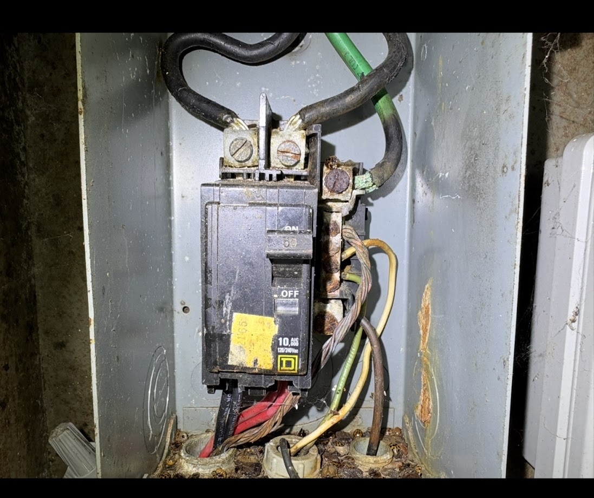
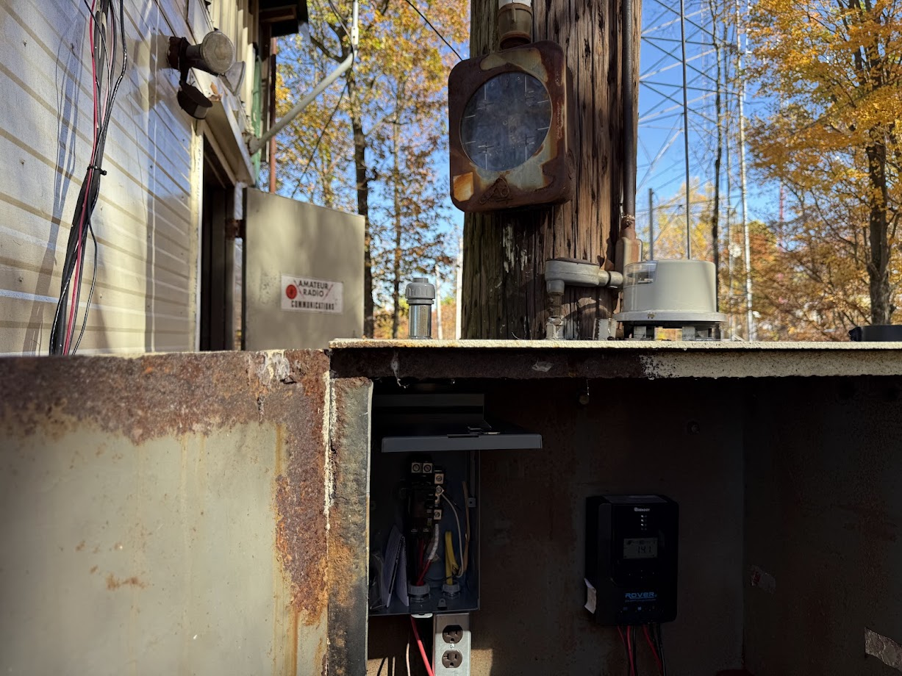
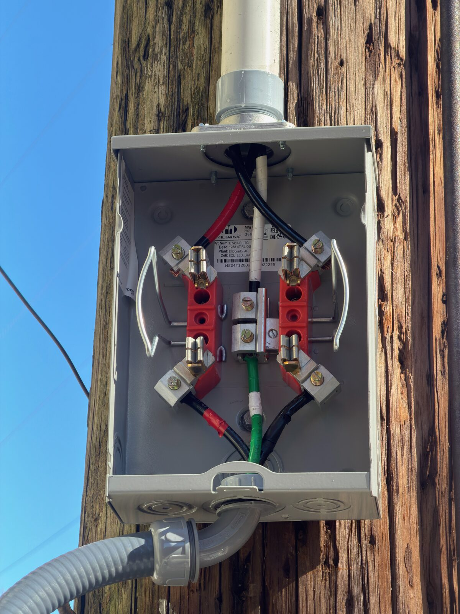
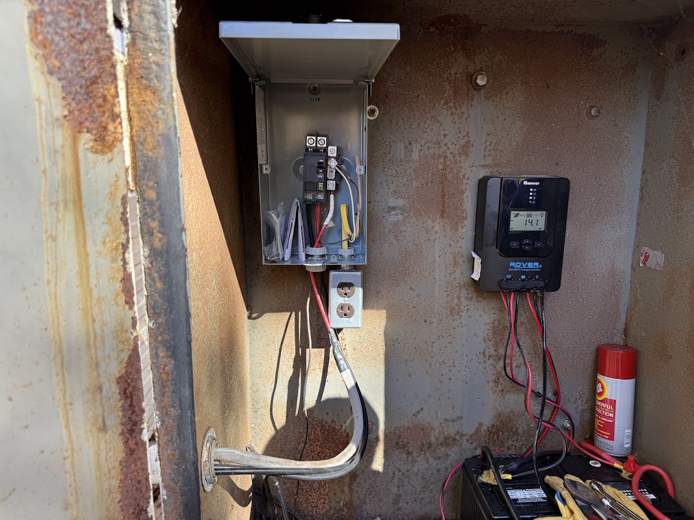

It started with a text: "The repeaters are down." I got to a radio, keyed up, and sure enough, nothing was working right. I let our repeater team know, and we started planning a trip up Bays Mountain.

## Finding the Problem

For safety, we never send fewer than two people up the mountain, especially when there's power work involved. A few days later we had a team together and made the trip.

Once we got there, the problems were obvious, and strange. The main 2-meter repeater kept rebooting and wouldn't stay up. Stranger still, the lights flickered whenever we switched the repeaters off. That pointed us to a bad neutral somewhere. We took the breaker panels apart and found old, deteriorated wiring in the disconnect outside the shack. That was our culprit.

To be safe, we shut everything down and disconnected it from utility power, which took the repeaters off the air completely.

You might be wondering, "Don't we have a solar backup?" We wondered the same thing. We'd replaced the solar charge controller and battery not long ago, but the system wasn't carrying the load. After more digging we found why: an exposed connection had corroded, so the panels weren't charging anything.

## Making a Plan

With both problems identified, we came down the mountain, met with a few members, and worked out what equipment needed replacing.

Then came the waiting. We needed decent weather, a day the team could all make it, and a visit from AEP to disconnect power so we could work safely. A few weeks later the parts were bought and everything was lined up.

## The Repair

On the next trip we split into two teams: one replaced the main disconnect and its housing, and the other rebuilt the solar backup.

**AC power:** The wiring from the transformer to the shack was in bad shape, so we replaced all of it: new wire, new conduit, a new breaker, a new meter base, and new outside outlets.

**Solar backup:** We replaced the wiring from the roof panels to the charge controller, and swapped the single dead battery for two new ones.

## Running on Sunshine

Because of AEP's schedule, the site ran on battery alone for a full week before power was restored. That turned out to be a great real-world test, and the backup system passed: we never noticed a single drop. The new batteries should keep the repeaters on the air for days even without sun.

Once AEP reconnected service, we brought everything back up, and thankfully it all worked.

## Back on the Air

The repeaters are back in full-time service. A big thank-you to everyone who made the trips up the mountain, and to AEP for working with us on the disconnect and reconnect.

Frequencies, tones, and current status are on our [Repeaters page](/repeaters). Get on and give them a try!
